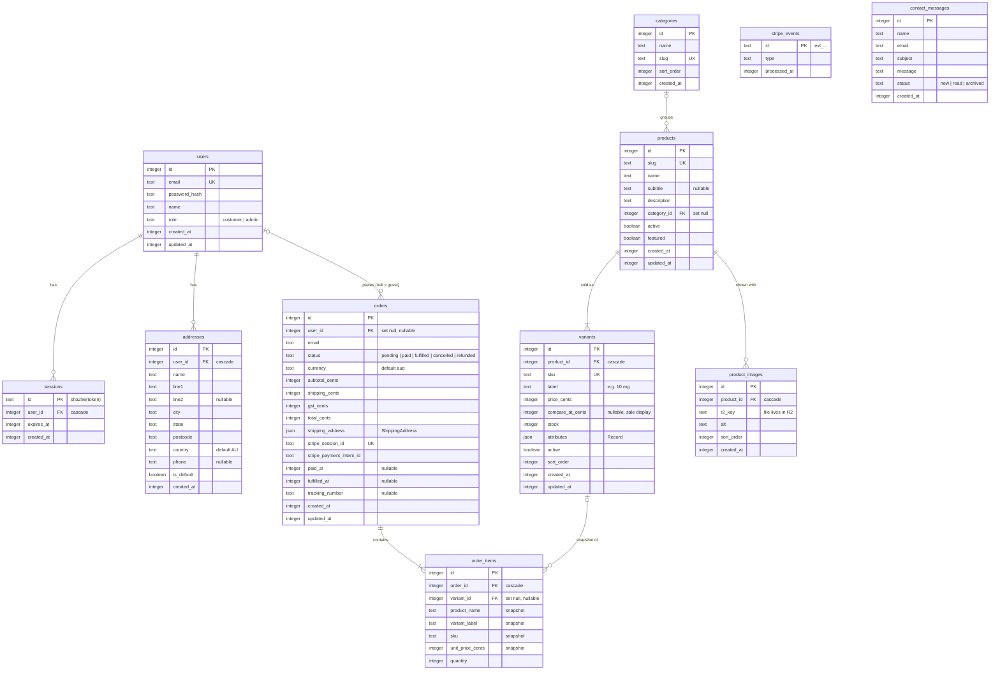
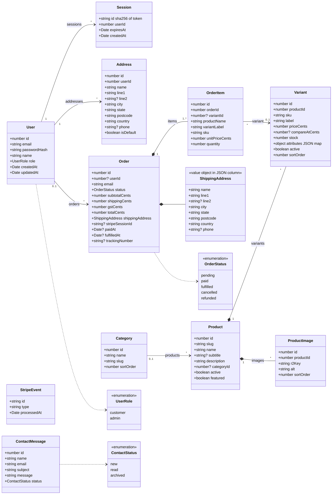

# Diagrams

Visual reference for the API (`apps/api`). Diagrams use [Mermaid](https://mermaid.js.org), which GitHub renders natively. In VS Code, install a Mermaid preview extension (e.g. "Markdown Preview Mermaid Support").

**Easier to read:** open [diagrams.html](diagrams.html) in a browser — full screen, scroll to zoom, drag to pan, export SVG. It holds copies of the blocks below; keep both in sync.

Source of truth is the code. When `apps/api/src/db/schema.ts` or the layer structure changes, update this file in the same PR.

- [1. Database schema (ER diagram)](#1-database-schema-er-diagram)
- [2. Domain model (class diagram)](#2-domain-model-class-diagram)
- [3. API layers (class diagram)](#3-api-layers-class-diagram)

## 1. Database schema (ER diagram)

Every table in D1, with columns, keys and foreign keys. Money is integer cents (AUD, GST-inclusive); timestamps are unix seconds.

`stripe_events` and `contact_messages` stand alone: no foreign keys.

**On delete**

| Parent deleted | Child rows |
|---|---|
| user | sessions, addresses deleted; orders kept with `user_id = null` |
| category | products kept with `category_id = null` |
| product | variants, product_images deleted |
| order | order_items deleted |
| variant | order_items kept with `variant_id = null` (snapshot columns keep history correct) |

## 2. Domain model (class diagram)

Same data seen as objects, the way Drizzle relations expose it (`db.query.products.findFirst({ with: { variants: true, images: true } })`). Field names are camelCase as in TypeScript. Association names match the keys in the `relations()` blocks of `schema.ts`.

Filled diamond (`*--`) = composition: child rows are deleted with the parent. Plain arrow = association: child survives (foreign key set null) or is owned by the user but not part of it.

## 3. API layers (class diagram)

How the code is split. Routes speak HTTP, services hold logic and take a `Db`, lib holds pure helpers. Arrows mean "calls / depends on". See [architecture.md](architecture.md#layers) for the rules.

```mermaid
classDiagram
    direction TB

    class App {
        <<index.ts — OpenAPIHono app>>
        secureHeaders()
        cors()
        csrf()
        loadSession
        requireAdmin on admin routes
        errorHandler
    }
    class AppEnv {
        <<type>>
        Bindings: Env  DB, BUCKET, SHOP_URL, ADMIN_URL, STRIPE_*, shipping vars
        Variables: user  User or null
    }

    class healthRoute {
        <<route /api/health>>
    }
    class authRoute {
        <<route /api/auth>>
    }
    class categoriesRoute {
        <<route /api/categories>>
    }
    class productsRoute {
        <<route /api/products>>
    }
    class imagesRoute {
        <<route /api/images>>
    }
    class contactRoute {
        <<route /api/contact>>
    }
    class checkoutRoute {
        <<route /api/checkout>>
    }
    class stripeRoute {
        <<route /api/stripe>>
    }
    class adminCategoriesRoute {
        <<route /api/admin/categories>>
    }
    class adminProductsRoute {
        <<route /api/admin/products>>
    }
    class adminVariantsRoute {
        <<route /api/admin/variants>>
    }
    class adminImagesRoute {
        <<route /api/admin/images>>
    }
    class adminContactRoute {
        <<route /api/admin/contact>>
    }

    class authMiddleware {
        <<middleware/auth.ts>>
        loadSession
        requireAuth
        requireAdmin
        currentUser(c) User
        setSessionCookie(c, token, expiresAt)
        clearSessionCookie(c)
        getSessionToken(c)
    }
    class errorMiddleware {
        <<middleware/error.ts>>
        errorHandler(err, c)
    }

    class authService {
        <<services/auth.ts>>
        createUser(db, input) User?
        verifyCredentials(db, input) User?
        createSession(db, user) token, expiresAt
        getSessionUser(db, token) User?
        deleteSession(db, token)
    }
    class catalogService {
        <<services/catalog.ts>>
        listCategories(db) Category[]
        getCategoryBySlug(db, slug) Category?
        listProducts(db, query) Paginated~ProductSummary~
        getProductBySlug(db, slug) ProductDetail?
        firstImageByProduct(db, ids) Map
    }
    class contactService {
        <<services/contact.ts>>
        submitContactMessage(db, input)
    }
    class checkoutService {
        <<services/checkout.ts>>
        createCheckout(db, stripe, config, input, user) CheckoutCreated
        cancelPendingOrder(db, orderId) boolean
        getCheckoutSessionStatus(db, sessionId) CheckoutSessionStatus?
        shippingFor(subtotalCents, config) number
    }
    class stripeWebhookService {
        <<services/stripe-webhook.ts>>
        handleStripeEvent(db, event)
    }
    class adminCatalogService {
        <<services/admin-catalog.ts>>
        categories: list, get, create, update, delete
        products: list, get, create, update, delete
        variants: create, update, delete
    }
    class adminImagesService {
        <<services/admin-images.ts>>
        uploadProductImage(db, bucket, productId, input) AdminProductImage?
        updateProductImage(db, id, input) AdminProductImage?
        deleteProductImage(db, bucket, id) boolean
    }
    class adminContactService {
        <<services/admin-contact.ts>>
        listContactMessages(db, query) Paginated~AdminContactMessage~
        getContactMessage(db, id) AdminContactMessage?
        updateContactMessage(db, id, input) AdminContactMessage?
        deleteContactMessage(db, id) boolean
    }

    class openapiLib {
        <<lib/openapi.ts>>
        createRouter()
        json(schema, description)
        errors
        cookieAuth
        slugParams(example)
        idParams(example)
        adminTags
    }
    class passwordLib {
        <<lib/password.ts>>
        hashPassword(pw) string
        verifyPassword(pw, stored) boolean
    }
    class sessionLib {
        <<lib/session.ts>>
        SESSION_COOKIE
        sessionTtlMs(role)
        newSessionToken()
        hashSessionToken(token)
    }
    class paginationLib {
        <<lib/pagination.ts>>
        pageOffset(page, limit)
        paginated(items, total, page, limit)
    }
    class sqlLib {
        <<lib/sql.ts>>
        containsText(column, term)
        isUniqueViolation(err) boolean
    }
    class imagesLib {
        <<lib/images.ts>>
        imageUrl(r2Key)
        sniffImageType(bytes) type, ext
    }
    class stripeLib {
        <<lib/stripe.ts>>
        getStripe(env) Stripe
    }

    class Db {
        <<db/client.ts — Drizzle over D1>>
        getDb(d1) Db
    }
    class schema {
        <<db/schema.ts>>
        tables + relations
    }
    class shared {
        <<packages/shared — zod schemas + types>>
    }
    class R2 {
        <<Cloudflare R2 bucket>>
    }
    class Stripe {
        <<Stripe API — Checkout Sessions, webhook signatures>>
    }

    App --> AppEnv
    App --> healthRoute
    App --> authRoute
    App --> categoriesRoute
    App --> productsRoute
    App --> imagesRoute
    App --> contactRoute
    App --> checkoutRoute
    App --> stripeRoute
    App --> adminCategoriesRoute
    App --> adminProductsRoute
    App --> adminVariantsRoute
    App --> adminImagesRoute
    App --> adminContactRoute
    App --> authMiddleware
    App --> errorMiddleware

    authRoute --> authService
    authRoute --> authMiddleware
    categoriesRoute --> catalogService
    productsRoute --> catalogService
    contactRoute --> contactService
    checkoutRoute --> checkoutService
    checkoutRoute ..> stripeLib
    stripeRoute --> stripeWebhookService
    stripeRoute ..> stripeLib
    stripeWebhookService --> checkoutService
    checkoutService --> Stripe
    stripeLib ..> Stripe
    imagesRoute --> R2
    adminCategoriesRoute --> adminCatalogService
    adminProductsRoute --> adminCatalogService
    adminProductsRoute --> adminImagesService
    adminVariantsRoute --> adminCatalogService
    adminImagesRoute --> adminImagesService
    adminContactRoute --> adminContactService
    adminCatalogService --> R2
    adminImagesService --> R2

    healthRoute ..> openapiLib
    authRoute ..> openapiLib
    categoriesRoute ..> openapiLib
    productsRoute ..> openapiLib
    imagesRoute ..> openapiLib
    contactRoute ..> openapiLib
    checkoutRoute ..> openapiLib
    stripeRoute ..> openapiLib
    adminCategoriesRoute ..> openapiLib
    adminProductsRoute ..> openapiLib
    adminVariantsRoute ..> openapiLib
    adminImagesRoute ..> openapiLib
    adminContactRoute ..> openapiLib
    openapiLib ..> shared

    authMiddleware --> authService
    authMiddleware ..> sessionLib
    authService ..> passwordLib
    authService ..> sessionLib
    catalogService ..> paginationLib
    catalogService ..> sqlLib
    catalogService ..> imagesLib
    adminCatalogService ..> catalogService
    adminCatalogService ..> paginationLib
    adminCatalogService ..> sqlLib
    adminCatalogService ..> imagesLib
    adminImagesService ..> imagesLib
    adminContactService ..> paginationLib
    adminContactService ..> sqlLib

    authService --> Db
    catalogService --> Db
    contactService --> Db
    checkoutService --> Db
    stripeWebhookService --> Db
    adminCatalogService --> Db
    adminImagesService --> Db
    adminContactService --> Db
    Db --> schema
```

Rule of thumb: arrows only point down (route → service → Db). Services never import from `routes/` or Hono, so other routes can reuse them: the Stripe webhook service calls `cancelPendingOrder` from the checkout service.
